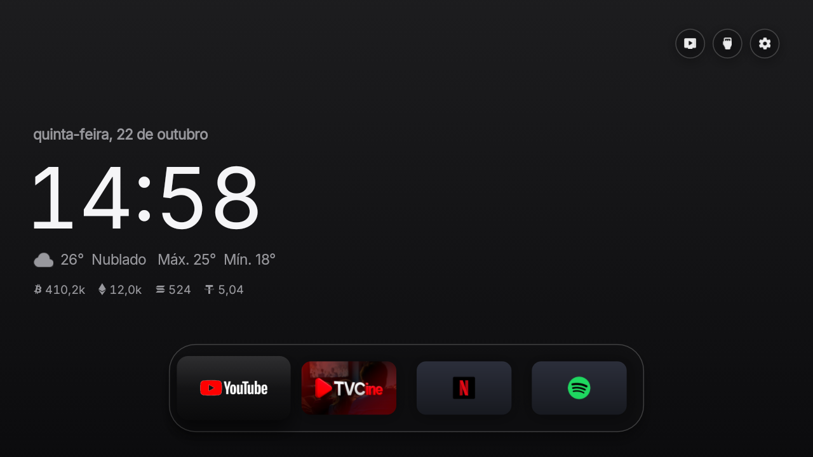
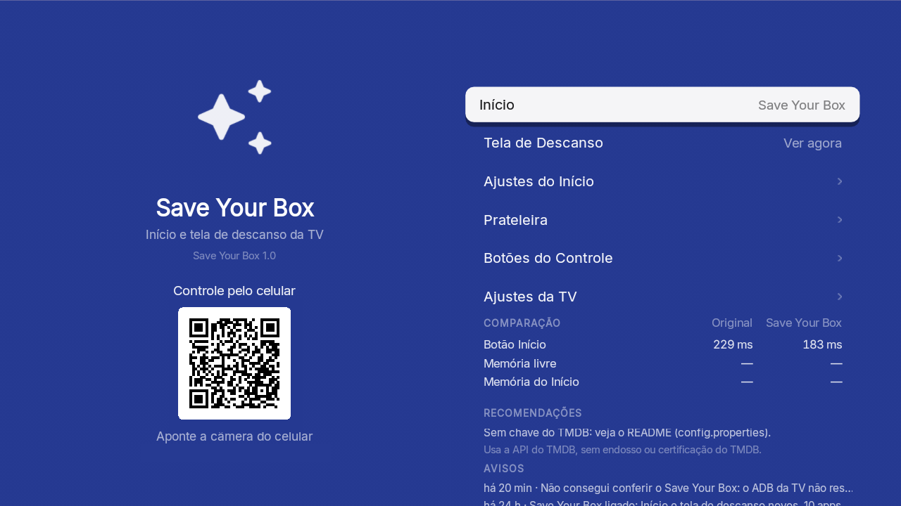
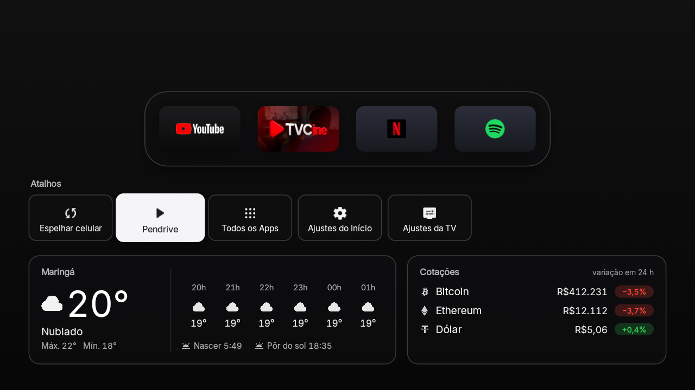
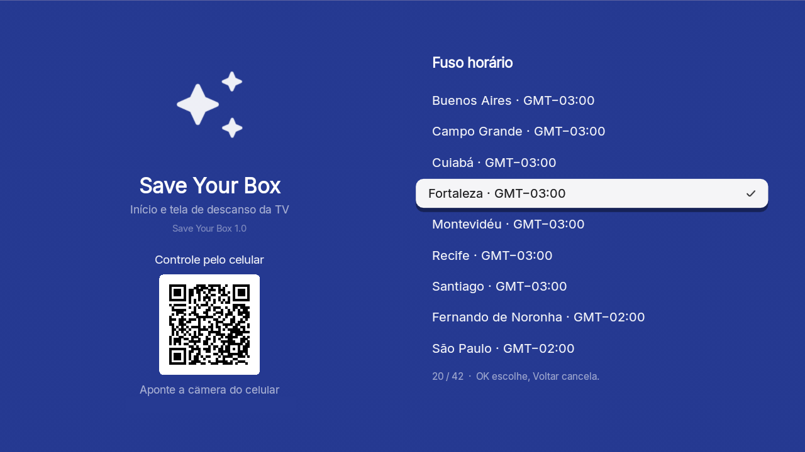

<div align="center">

# Save Your Box

### That cheap Android TV box under your TV may be working for someone else. Take it back.

**Safer. Faster. Clean. Fun.** An ad-free home screen, your phone as a remote, and the fixes an old "MXQ Pro"-style
box badly needs. Built with Claude Code.

[Why](#the-box-in-your-living-room) · [What it does](#what-save-your-box-does) · [Retro games](#optional-retro-games) · [Install](#install) · [Português](#em-português)

 

</div>

## The box in your living room

**June 2025. The FBI issues a public warning** ([IC3 alert I-060525-PSA](https://www.ic3.gov/PSA/2025/PSA250605)):
a China-based botnet called **BADBOX 2.0** has taken over **more than a million** off-brand Android devices, mostly
cheap TV streaming boxes. Some come infected **from the factory**; others get the malware from the "free content"
apps and unofficial stores they push you to. Once inside, criminals sell **your home internet connection** to
others as a proxy, click ads behind your back, and use the box as a door into your network.

**July 2025. Google sues 25 people in China** over the same botnet and puts it at **more than 10 million devices**,
"the largest known botnet of internet-connected TV devices"
([The Register](https://www.theregister.com/2025/07/17/google_sues_25_unnamed_chinese/),
[The Hacker News](https://thehackernews.com/2025/07/google-sues-25-chinese-entities-over.html)).

**And it isn't new.** In 2016, researchers found that update software from **Adups, a Shanghai company**, was sending
phone owners' **text messages and call logs to its servers in China every 72 hours**, disguised as update traffic,
on more than 100,000 phones sold in the US
([TechCrunch](https://techcrunch.com/2016/11/15/budget-us-android-smartphones-found-secretly-sending-personal-data-to-china/),
[Dark Reading](https://www.darkreading.com/mobile-security/firmware-secretly-sent-text-call-data-on-android-users-to-china)).

**Our box** was a no-name "MXQ Pro 5G": a name that appears in the security reports on factory backdoors
([Tom's Guide](https://www.tomsguide.com/news/thousands-of-android-tv-boxes-infected-with-dangerous-malware-linked-to-fraud)).
Here's what we found inside:

| Found on our box | Why it matters |
|---|---|
| The **Adups updater**, switched on | The same company as in 2016, as a system app that can install software |
| **Not Play Protect certified** | One of the FBI's own warning signs; the Play Store won't even open app pages |
| **Root from the factory**, and an ADB that asks no password | Turn on network ADB and anyone on your Wi-Fi gets full control |
| **SELinux switched off** | Android's core security wall, the one that keeps apps from each other's data, wasn't there |
| The system says **4 GB** of memory | About **2 GB** real: the rest is a made-up number |
| **24 Hz** video, **no app ever compiled**, a clock back in **1970** after a reboot | YouTube took **40 seconds** to open |

We didn't find the known BADBOX 2.0 files on ours. No scan can promise a box is clean, though: malware in the
firmware can hide. If yours shows ads out of nowhere, gets hot when idle, or asks you to turn off Play Protect,
**unplug it and replace it.** For the rest, here's how to take yours back.

## What Save Your Box does

### 🛡️ Safer

- Turns off the **Adups updater**, the factory test apps and the Assistant, without uninstalling anything: one button
  (*Original*) brings it all back.
- Keeps the box's real pieces safe (Chrome is its web engine on Android 7; the front panel clock; mirroring).
- The phone remote only answers your home network, and only with the key in the QR code on your TV.
- [CLAUDE.md](CLAUDE.md) walks Claude Code through checking your box for the known BADBOX 2.0 files, servers and
  warning signs. And put the box on your router's **guest network**, away from your computer and phones.

### ⚡ Faster

- **Compiles the apps** these boxes never compile: YouTube went from **32-40 s to 3.8 s** to open, TVCine from up to
  35 s to 2.5 s.
- **HDMI at 60 Hz** instead of 24, free memory up by about **190 MB**, and the clock set by itself (it had no time
  server).

### ✨ Clean

- **No ads**, no sponsored rows, no promo apps: your apps on a glass shelf, the weather, the clock.
- **Time zone in the settings**, with the offset each zone really has on that box (old boxes still apply abolished
  summer times), and the weather's sunrise and sunset right again.
- **Your own photo as the background**, switched on and off in the settings.

### 🎮 Fun

- **Your phone is the remote.** Scan the QR code in the settings, nothing to install: arrows, OK, **typing for
  search**, the box's apps, a **sleep timer**, and **your photos on the screensaver**. Keys take 0.1 to 0.3 s.
- **It works the TV too.** Boxes like this rarely have working HDMI-CEC. A TCL TV that isn't Android takes keys over
  the network instead: the phone does its **volume, input and power**, and "turn off" and the timer turn off both.
- **Shortcuts** to mirror your phone on the TV and to play what's on a USB drive.
- **Retro games,** optional, below.

 

## Optional: retro games

[RetroArch](https://www.retroarch.com) turns the box into a retro console: NES, Super Nintendo, Mega Drive, Game Boy
Advance and PlayStation run well even on these slow chips.

- **Get it from its makers.** The Play Store won't open its page on an uncertified box, so use the official 32-bit
  build, `RetroArch_ra32.apk`, from [buildbot.libretro.com/stable](https://buildbot.libretro.com/stable/) (signed by
  Libretro), and the cores from RetroArch's own *Online Updater*. Never from an "APK site".
- **Put your games in a `ROMs` folder** (one per console); Claude Code can set RetroArch to open there and install
  the cores for NES, SNES, Mega Drive, Game Boy, GBA and PlayStation from the same official server.
- **Plug in a controller**, USB or Bluetooth. The phone remote is fine for menus, not for games.
- **Games:** free homebrew (there's plenty, on [itch.io](https://itch.io/games/tag-nes) and elsewhere) or copies of
  cartridges you own. Downloading commercial games you don't own is illegal in most countries, and ROM sites are a
  favorite place to hide malware.

## Install

About fifteen minutes. You need an Android TV box (Android 7.1 or newer), a Google TV or an Android TV, and a computer
on the same Wi-Fi.

### The easy way: an AI assistant

1. **On the box**, turn on developer mode: Settings → About → press *Build number* 7 times (on a Google TV: Settings →
   System → About → *Android TV OS build*). Then, in Developer options, turn on **USB debugging** and, on boxes that
   have it, **Internet ADB** / ADB over network. Write down the box's IP address (Settings → Network).
2. **On your computer**, open an AI coding assistant ([Claude Code](https://claude.com/claude-code), Codex or
   Antigravity) and say:
   > Install Save Your Box (github.com/felipe-nantes/save-your-box) on my box at 192.168.1.50. I live in Lisbon.

   It downloads the code, installs the tools it needs, builds the app, puts it on your box, compiles your apps and
   checks the box, and asks before anything important. Swap in your box's IP and your city.
3. **On the box**, open *Save Your Box* → *Home Screen* → *Save Your Box*, and accept the debugging prompt if it asks
   (tick *Always allow*).

### The manual way

1. **On the box**, do step 1 above.
2. **Tools:** a JDK (17+), the Android SDK command-line tools (build-tools 34 or newer, platform android-34) and adb.
   On a Mac:
   ```bash
   brew install --cask temurin android-commandlinetools android-platform-tools
   sdkmanager "build-tools;36.0.0" "platforms;android-34"
   ```
   On Linux, get OpenJDK 17, Android's command-line tools and adb from your package manager, then run the same
   `sdkmanager` line. On Windows, use Git Bash (which Claude Code uses there) or WSL. With JDK 21, use build-tools 36:
   34's d8 fails on its classes.
3. **Build:**
   ```bash
   ./build.sh
   ```
   The first run creates `config.properties`. Set your city (and, if you want the picks, your [TMDB key](#the-tmdb-key))
   there, then run it again.
4. **Install:**
   ```bash
   adb connect 192.168.1.50:5555
   adb install -r SaveYourBox.apk
   adb shell cmd package compile -m speed -f io.freemytv
   ```
   The last line compiles it: old boxes never do. On TCL TVs, also let it run in the background (TCL blocks it by
   default, and the switch never starts):
   ```bash
   adb shell "appops set io.freemytv AUTO_START allow || appops set io.freemytv APP_AUTO_START allow"
   ```
   Some boxes' ADB takes one connection at a time: run `adb disconnect` before the next step.
5. **On the box**, open *Save Your Box* → *Home Screen* → *Save Your Box*.

## Settings

The first values come from `config.properties`, created by the first build. Most of them can also be changed on the box,
in *Save Your Box* → *Home Settings*, and the box's choice wins:

| Key | What it does | Default |
|---|---|---|
| `tmdb_key` | Your free TMDB key, for the trending picks | empty |
| `tmdb_region` | Your country (two letters): which titles are on which app | `US` |
| `watchmode_key` | Optional, free [Watchmode](https://api.watchmode.com/) key: a pick opens the title's page in its app | empty |
| `latitude`, `longitude` | Your city, for the weather and the sunset | New York |
| `city` | The name on the weather card | `Weather` |
| `wallpaper` | Your own photo as the background (a path from the folder, like `../photo.jpg`) | empty |
| `show_wallpaper` | Whether that photo shows from the start (*Home Settings* → *Background photo* switches it) | `true` |
| `hide_animation` | Leave cartoons and anime out of the picks | `false` |
| `language` | `auto` (follows the box), or a language with a [translation](#translations) (`en`, `pt`, `es`, `de`, `ru`, `fr`, `ja`…) | `auto` |
| `show_crypto` | Show Binance crypto prices on home and screensaver | `true` |
| `currency` | Crypto prices in `USD`, `EUR`, `BRL`… | `USD` |
| `temperature` | `C`, `F` or `auto` | `auto` |
| `disable_assistant` | Also turn off Google Assistant (it takes about 110 MB on a small box) | `false` |
| `hide_services` | Streaming services to leave out of the picks even when their app is there (`netflix`, `prime`, `disney`…), comma separated | empty |

On the box only: *Time zone* (the zones with the offset that box really uses for each), the theme, the shelf and the
remote buttons.

Changed something? Run `./build.sh` and install again. Keep `freemytv.keystore`: updates are signed with it.

### The TMDB key

Free, and it takes two minutes: create an account at [themoviedb.org](https://www.themoviedb.org/signup), then open
[Settings → API](https://www.themoviedb.org/settings/api) and request a developer key. Paste the *API Read Access Token*
(or the *API Key*) after `tmdb_key=`. It's your key: `config.properties` stays out of git. Without it, everything works
but the picks and their photos on the screensaver (yours from the phone still show).

### Opening a title, not just its app (optional)

With a free [Watchmode](https://api.watchmode.com/) key (`watchmode_key=` in `config.properties`), a pick opens its own
page in the streaming app instead of the app's home. The free plan (2,500 credits a month) is enough: each title costs
two requests the first time and is remembered after that.

## Going back

On the box: *Save Your Box* → *Home Screen* → *Original*. The factory home screen, screensaver and every app come back
exactly as they were. If the new home screen ever crashes three times in five minutes, it switches back by itself.

To remove it for good, switch to *Original* first, then uninstall *Save Your Box* (Settings → Apps). Uninstalled it while
it was on? Install it again and pick *Original*: the list of what it turned off is kept in the system's settings, so
everything comes back.

## What it changes

- It becomes the home screen and the screensaver.
- It turns off, without uninstalling:
  - the stock home screen and screensaver;
  - on no-name Rockchip boxes ("MXQ Pro", Android 7.1), the Adups updater and the factory tests, plus TalkBack, the
    Chinese keyboard and live wallpapers there;
  - Google TV's recovery home, Play Games and YouTube Music;
  - on TCL TVs, the TCL Channel, messages, store demo, hotel menu, manuals, mirroring and logging apps;
  - on Philco TVs, AI PONT (promo channels and app downloads) and the manual;
  - on Multilaser and KTC-made (NextStar) TVs, Anoki's screen-content recognition (ACR), the store demo and the manual;
  - Google Assistant, only with `disable_assistant=true`.
- On TCL, Vestel, KTC and Sony TVs and Formovie projectors, the remote's app buttons can each open the app you pick
  (*Save Your Box* → *Remote Buttons*), through a small accessibility service that only reads those buttons; *Original*
  turns it off.
- Picture, sound, inputs, remote pairing, Google services, the Play Store, and on boxes Chrome (their web engine), the
  front panel clock, mirroring and the USB player are on a protected list, checked before every change.
- Apps that saved a Wi-Fi network are never turned off, since Android would erase the network.

## Any box, any TV

It runs on Android TV boxes from Android 7.1 (Rockchip, Amlogic and the rest), on Google TV and Android TV sets (TCL,
Sony, Hisense, Philips, Xiaomi, Vestel-made, KTC-made and more) and on streamers like Chromecast with Google TV, the
Google TV Streamer, onn 4K and NVIDIA Shield. A TV that isn't Android: plug a box into its HDMI.

**A different brand or model:** ask Claude. It's made to be adapted by AI. Open the folder in Claude Code and say
*"set it up for my box"*: it reads your device, finds its home screen and its junk apps, updates the lists below and
walks you through a test. [CLAUDE.md](CLAUDE.md) tells it how.

| What | Where |
|---|---|
| Apps to turn off | `DEBLOAT` in [`HomeMode.java`](app/src/io/freemytv/HomeMode.java) |
| Apps never to touch | `PROTECTED` in the same file |
| Apps on the shelf | `SHELF` in [`HomeApps.java`](app/src/io/freemytv/HomeApps.java) |
| Your brand's live TV app | `LIVE_TV_APPS` in the same file |

## How it works

- **A plain Android app, no Gradle, no libraries.** [`build.sh`](build.sh) runs aapt2 → javac → d8 → zipalign →
  apksigner and makes a 1.4 MB APK.
- **It uses the box's own ADB, from inside the box.** The app connects to `127.0.0.1:5555` with its own key and runs
  the same commands you would: `cmd package set-home-activity`, `settings put secure screensaver_components`,
  `pm disable-user`.
- **The phone remote** is a small web server in the app, on your home network only, behind the key in the QR code. Its
  keys go straight to the input device of the box's own remote (the codes from its key layout), so they take a tenth of
  a second, not the two seconds of `input keyevent` on a slow box. A TCL TV gets its keys over its own network
  remote protocol (TCP 4123).
- **Drawn by hand on one Canvas**, with Android 13 shaders for the frosted glass and the sky (plain fills and lighter
  shadows on Android 7.1 to 12, for their older GPUs).
- **A safety net.** A watchdog in a separate process brings back the stock home screen after three crashes in five
  minutes, and a boot check keeps your choice after system updates.
- **Data** from TMDB (trending titles and which app streams what in your country), Open-Meteo (forecast, sunrise and
  sunset), and optionally Binance (24-hour prices when `show_crypto=true`).

| File | What it is |
|---|---|
| [`HomeView.java`](app/src/io/freemytv/HomeView.java) | The home screen |
| [`HomeMode.java`](app/src/io/freemytv/HomeMode.java) | Switching between Save Your Box and Original, the time zone |
| [`Adb.java`](app/src/io/freemytv/Adb.java) | The box's own ADB, from inside the box |
| [`RemoteServer.java`](app/src/io/freemytv/RemoteServer.java), [`remote.html`](app/assets/remote.html) | The phone remote |
| [`RemoteInput.java`](app/src/io/freemytv/RemoteInput.java) | Its keys and text, into the box |
| [`TclTv.java`](app/src/io/freemytv/TclTv.java) | A TCL TV over the network |
| [`Qr.java`](app/src/io/freemytv/Qr.java) | The QR code |
| [`Recs.java`](app/src/io/freemytv/Recs.java) | The picks (TMDB) |
| [`HomeData.java`](app/src/io/freemytv/HomeData.java) | Weather and prices |
| [`HomeApps.java`](app/src/io/freemytv/HomeApps.java) | The shelf, inputs, the drawer and All Apps |
| [`DreamView.java`](app/src/io/freemytv/DreamView.java), [`Photos.java`](app/src/io/freemytv/Photos.java) | The screensaver and your photos |
| [`SettingsActivity.java`](app/src/io/freemytv/SettingsActivity.java) | The settings screen (the app's icon) |
| [`Prefs.java`](app/src/io/freemytv/Prefs.java) | Settings changed on the box |
| [`Watchdog.java`](app/src/io/freemytv/Watchdog.java) | The safety net |

## Translations

Each language is one file, [`app/assets/i18n/<lang>.json`](app/assets/i18n), keyed by the English text in the code.
*Automatic* follows the system's language and uses any language that has a file (English otherwise); *Home Settings* →
*Language* lists them all. Today: English, Portuguese, Spanish, German, French, Italian, Dutch, Polish, Swedish, Danish,
Norwegian, Finnish, Czech, Romanian, Turkish, Russian, Ukrainian, Greek, Japanese, Korean, Simplified Chinese, Hindi,
Indonesian and Vietnamese. Corrections from native speakers are welcome.

- **Add a language:** `python3 tools/translate.py --new ca`, then fill `app/assets/i18n/ca.json` by hand, or with
  `ANTHROPIC_API_KEY` set, `python3 tools/translate.py --fill --lang ca` (only the strings go to the API).
- **After changing text in the code:** `python3 tools/translate.py` lists what each language lacks; `--fill` translates
  only that, `--prune` drops strings the code no longer uses, `--check` validates all catalogues.
- Text built at runtime has placeholders (`"{n} min ago"`), and counts have plural forms
  (`"plural|one:{n} season|other:{n} seasons"`), so each language puts the words in its own order.
- Right-to-left languages would need the layout mirrored, so they aren't there yet. Chinese, Japanese, Korean and
  Hindi are drawn with the system font (Inter has no such letters).

## Privacy

No accounts, no analytics, no tracking. The app talks to TMDB, Open-Meteo (with the coordinates you set), Binance only
when `show_crypto=true`, and Watchmode only when you set a `watchmode_key`. The phone remote and the TV control stay on
your home network. Your settings and photos stay on your computer and your box.

## Credits

- Built with [Claude Code](https://claude.com/claude-code).
- This product uses the TMDB API but is not endorsed or certified by [TMDB](https://www.themoviedb.org/).
- Links to the titles in the streaming apps by [Watchmode](https://api.watchmode.com/).
- Weather data by [Open-Meteo.com](https://open-meteo.com/) (CC BY 4.0). Prices from the [Binance](https://www.binance.com/) public API.
- TCL's network remote protocol as found by [popeen/TCL-TV-Remote](https://github.com/popeen/Home-Assistant-Custom-Component-TCL-Remote) (MIT).
- Icons: [Material Symbols](https://fonts.google.com/icons) (Apache 2.0). Font: [Inter](https://rsms.me/inter/) (SIL OFL 1.1). Coin logos: [cryptocurrency-icons](https://github.com/spothq/cryptocurrency-icons) (CC0).
- [RetroArch](https://www.retroarch.com) is a separate project by Libretro; it's suggested here, not bundled.
- Not affiliated with Google, TCL, Rockchip, Libretro or any streaming service. App names and logos belong to their owners.

## License

[MIT](LICENSE). Fork it, change it, ship it.

## Em português

### Aquele TV box barato embaixo da sua TV pode estar trabalhando para outra pessoa. Retome o controle.

- **Junho de 2025:** o **FBI** emitiu um alerta público sobre a **BADBOX 2.0**, uma botnet que ele descreve como
  "baseada na China", com **mais de 1 milhão** de aparelhos Android genéricos, a maioria TV boxes baratos. Alguns já
  vêm infectados **de fábrica**. Os criminosos revendem a **sua internet** como proxy, clicam em anúncios escondidos e
  usam o box como porta para a sua rede ([alerta do FBI](https://www.ic3.gov/PSA/2025/PSA250605)).
- **Julho de 2025:** o **Google processou 25 pessoas na China** pela mesma botnet, com **mais de 10 milhões** de
  aparelhos ([The Register](https://www.theregister.com/2025/07/17/google_sues_25_unnamed_chinese/)).
- **2016:** o atualizador da **Adups**, uma empresa de Xangai, mandava **SMS e histórico de chamadas** dos usuários
  para servidores na China **a cada 72 horas** ([TechCrunch](https://techcrunch.com/2016/11/15/budget-us-android-smartphones-found-secretly-sending-personal-data-to-china/)).
  **O nosso box veio com esse atualizador ligado.**

O Save Your Box deixa o seu box:

- 🛡️ **Mais seguro:** desliga o Adups, os apps de teste de fábrica e o Assistente (um botão traz tudo de volta), e o
  controle pelo celular só responde na sua rede, com a chave do QR code.
- ⚡ **Mais rápido:** o YouTube passou de **40 s para 3,8 s** para abrir. HDMI a 60 Hz, mais memória livre e hora certa.
- ✨ **Limpo:** sem anúncios, com fuso horário nos ajustes e a sua foto de fundo.
- 🎮 **Divertido:** o **celular vira controle** (setas, teclado, apps, timer, fotos no protetor de tela), controla a
  **TV TCL pela rede** (volume, entrada, liga/desliga) e, se quiser, **jogos retrô** com o RetroArch oficial.

Não achamos os arquivos conhecidos da BADBOX 2.0 no nosso, mas nenhuma varredura garante 100%. Se o seu mostra
anúncios do nada ou pede para desligar o Play Protect, **desligue da tomada e troque**. E deixe o box na **rede de
convidados** do roteador.

Para instalar, abra a pasta no Claude Code e diga: *"Instale no meu TV box no IP 192.168.0.50. Moro em São Paulo."*

<sub>Save Your Box isn't affiliated with the FBI, Google, TCL or Libretro. The facts above come from the public sources
linked.</sub>
